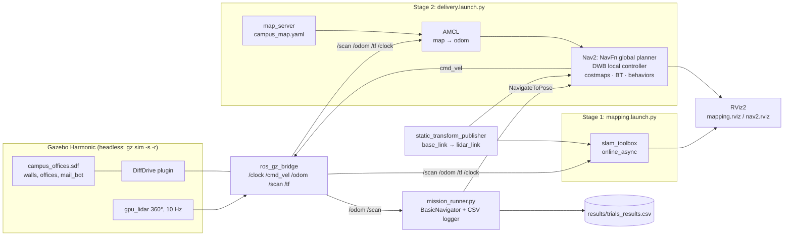

# 📬 Campus Mail Bot — Autonomous Indoor Office Delivery Robot

**Course:** DSAI 4304 Robotics Programming · **Instructor:** Dr. Shadia Yahya Baroud · **Semester:** First 2026–2027
**Stack:** Ubuntu 24.04 (VirtualBox, 2 CPU cores, no GPU) · ROS 2 Jazzy · Gazebo Harmonic · SLAM Toolbox · Nav2 · RViz2

A simulated differential-drive robot (`mail_bot`, 2D LiDAR + odometry) maps a compact 10 m × 8 m office floor
with SLAM Toolbox, localizes on the saved map with AMCL, and autonomously delivers mail from **Reception** to
**Office A, B and C** through Nav2. A mission node (`mission_runner`) executes two routes, logs distance,
time, goal completion and near-collision events to CSV, and lets the team compare a **baseline** Nav2
configuration (`inflation_radius 0.55`) against a **tuned** one (`inflation_radius 0.30`).

> **VirtualBox-first design:** Gazebo runs *headless* (`gz sim -s -r`) by default; RViz2 is the only GUI.
> Shadows are disabled, physics step is 0.004 s, Mesa software GL is forced, and every node uses `use_sim_time`.

## Team and roles

| Member | Primary role | Main deliverables |
|---|---|---|
| Sarah Abu Mandil | Simulation & robot lead | World/robot SDF, bridge, TF verification |
| Asala AbuGharara | Mapping & localization lead | SLAM Toolbox tuning, saved map, AMCL checks |
| Nada Abu Alkhair | Nav2 & experiments lead | Baseline/tuned parameters, 5+ trials, analysis |
| Aseel Abu Rabee | Integration, mission & documentation lead | `mission_runner`, report, demo video, README |

*(Roles are a proposed split — edit to match who really did what; every member must be able to explain all parts.)*

## System architecture



TF tree: `map → odom → base_link → lidar_link` (`map→odom`: SLAM/AMCL, `odom→base_link`: Gazebo DiffDrive via `/tf`,
`base_link→lidar_link`: static publisher).

## Repository tree

```
campus_mail_bot/
├── setup.sh                         # one-click install + build + git init
├── README.md
├── docs/
│   ├── 01_PROJECT_IDEA_AND_THEORY.md
│   ├── 02_STEP_BY_STEP_WORKFLOW_GUIDE.md
│   ├── 03_IEEE_TECHNICAL_REPORT_TEMPLATE.md
│   ├── 04_SOURCES_AND_REFERENCES.md
│   └── evidence/                    # TF tree, topic rates, screenshots
├── results/                         # trials_results.csv, trials_details.csv
├── scripts/                         # save_map.sh, export_tf_tree.sh
├── tools/                           # generate_world_and_map.py, make_nav2_params.py, summarize_results.py
└── src/campus_mail_bot/             # ROS 2 package (ament_python)
    ├── campus_mail_bot/mission_runner.py
    ├── launch/  sim_common.launch.py · mapping.launch.py · delivery.launch.py
    ├── config/  bridge.yaml · slam_params.yaml · nav2_baseline.yaml · nav2_tuned.yaml · routes.yaml
    ├── worlds/campus_offices.sdf
    ├── maps/    campus_map.yaml/.pgm    (starter map; overwrite with your SLAM map)
    └── rviz/    mapping.rviz · nav2.rviz
```

## Exact clean-start commands (for grading / reproducibility)

```bash
# 0) Fresh Ubuntu 24.04 VM, internet on.
git clone <YOUR_GITHUB_URL>/campus_mail_bot.git ~/campus_mail_bot    # or unzip into ~/campus_mail_bot
cd ~/campus_mail_bot
./setup.sh                                  # installs ROS 2 Jazzy/Gazebo/Nav2/SLAM Toolbox, builds, git init

# Every terminal:
cd ~/campus_mail_bot && source /opt/ros/jazzy/setup.bash && source install/setup.bash
```

**Phase 1 – Mapping (3 terminals)**
```bash
ros2 launch campus_mail_bot mapping.launch.py                 # T1
ros2 run teleop_twist_keyboard teleop_twist_keyboard          # T2 (drive slowly)
./scripts/save_map.sh                                         # T3 when the map is complete
```

**Phase 2 – Delivery + benchmark (2 terminals)**
```bash
# T1: Gazebo (headless) + AMCL + Nav2 + RViz  (baseline config)
ros2 launch campus_mail_bot delivery.launch.py params_file:=nav2_baseline.yaml
# T2: one automated trial
ros2 run campus_mail_bot mission_runner --route default --trial 1 --tag baseline
```
For the tuned configuration restart T1 with `params_file:=nav2_tuned.yaml` and use `--tag tuned_inflation`.
Full trial matrix (≥ 5 trials, both routes, both configs): `docs/02_STEP_BY_STEP_WORKFLOW_GUIDE.md`.
Summarize: `python3 tools/summarize_results.py > results/summary.md`.

No time to map? `maps/campus_map.yaml` is a generated starter map in the same map frame, so Phase 2 works immediately
(get the instructor's approval first, as the course brief requires, and explain the map in the report).

## Key design choices

* **Frames:** map frame = robot start pose (SLAM convention). `config/routes.yaml` stores world coordinates and
  `mission_runner` subtracts the start pose, so goals work with both your SLAM map and the starter map.
* **Nav2:** official Jazzy parameter file patched by `tools/make_nav2_params.py` (DWB controller, `robot_radius 0.24`,
  `use_sim_time` everywhere). Baseline vs tuned differ **only** in `inflation_radius` (0.55 → 0.30).
* **Metrics:** distance = Σ√(Δx²+Δy²) from `/odom`; time = simulation time; near-collision = `/scan` range < 0.22 m.

## Status / honesty note

Static checks done (SDF/YAML/Python syntax, generated map). The package has **not** been executed against a live
Jazzy + Harmonic install by the author of this template — run the workflow guide once and adjust timing/tolerances if needed.
Cite external code and any AI assistance in the report, as the course's academic-integrity rules require.
