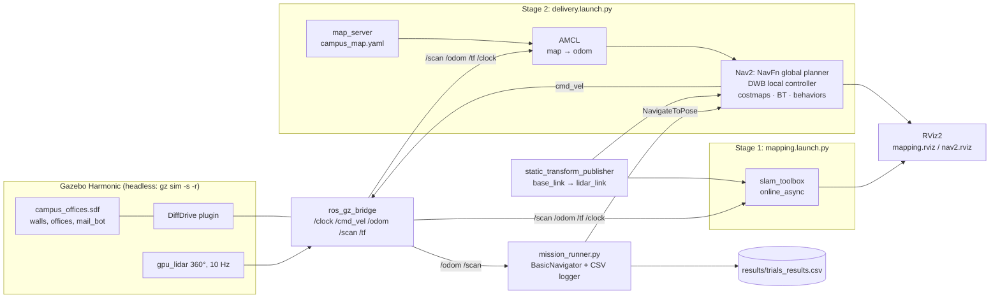

# Campus Mail Bot - Autonomous Indoor Office Delivery Robot

**Course:** DSAI 4304 Robotics Programming  
**Instructor:** Dr. Shadia Yahya Baroud  
**Semester:** First 2026–2027  
**Environment:** Ubuntu 24.04 (VirtualBox with 2 CPU cores and no GPU) | ROS 2 Jazzy | Gazebo Harmonic | SLAM Toolbox | Nav2 | RViz2

This project is a simulated indoor delivery robot (`mail_bot`) equipped with a 2D LiDAR and odometry sensors. The robot maps a 10 m by 8 m office floor using SLAM Toolbox and locates itself on the saved map using AMCL. Once localized, it uses Nav2 to autonomously deliver mail from the **Reception** area to **Office A, Office B, and Office C**. 

A custom mission node (`mission_runner`) runs two delivery routes and saves performance data like distance, time, goal completion, and near-collisions into CSV files. This data allows us to compare a default **baseline** Nav2 setup (`inflation_radius 0.55`) with our **tuned** setup (`inflation_radius 0.30`).

> **Performance Note for VirtualBox:** To keep the simulation smooth without a dedicated GPU, Gazebo runs in headless mode (`gz sim -s -r`) while RViz2 handles the visual display. We also disabled shadows, set the physics step to 0.004 seconds, enabled Mesa software GL, and configured all nodes to use `use_sim_time`.

---

## Team Members and Roles

| Member | Primary Role | Main Deliverables |
|---|---|---|
| **Sarah Abu Mandil** | Simulation & Robot Lead | World and robot SDF files, ROS-Gazebo bridge, and TF tree verification |
| **Asala AbuGharara** | Mapping & Localization Lead | SLAM Toolbox tuning, saving the map, and verifying AMCL localization |
| **Nada Abu Alkhair** | Nav2 & Experiments Lead | Baseline and tuned parameters, running 5+ test trials, and analyzing results |
| **Aseel Abu Rabee** | Integration, Mission & Docs Lead | Building `mission_runner`, writing the final report, demo video, and README |

*Note: Each team member contributed to the overall integration and is prepared to explain every part of the system.*

---

## System Architecture



**TF Tree Structure:** `map → odom → base_link → lidar_link`  
* `map → odom` is published by SLAM Toolbox or AMCL
* `odom → base_link` is published by the Gazebo DiffDrive plugin via `/tf`
* `base_link → lidar_link` is handled by a static transform publisher

---

## Repository Structure

```text
campus_mail_bot/
├── setup.sh                         # One-click script to install dependencies and build the workspace
├── README.md
├── docs/
│   ├── 01_PROJECT_IDEA_AND_THEORY.md
│   ├── 02_STEP_BY_STEP_WORKFLOW_GUIDE.md
│   ├── 03_IEEE_TECHNICAL_REPORT_TEMPLATE.md
│   ├── 04_SOURCES_AND_REFERENCES.md
│   └── evidence/                    # Saved TF trees, topic rates, and screenshots
├── results/                         # Generated CSV logs (trials_results.csv and trials_details.csv)
├── scripts/                         # Helper scripts (save_map.sh and export_tf_tree.sh)
├── tools/                           # Python scripts for generating worlds, tuning params, and summarizing data
└── src/campus_mail_bot/             # Main ROS 2 package (ament_python)
    ├── campus_mail_bot/mission_runner.py
    ├── launch/                      # sim_common, mapping, and delivery launch files
    ├── config/                      # YAML configurations for bridge, SLAM, Nav2, and routes
    ├── worlds/campus_offices.sdf
    ├── maps/                        # Saved map files (campus_map.yaml and campus_map.pgm)
    └── rviz/                        # Pre-configured RViz2 views for mapping and navigation
```

---

## How to Run the Project

### 1. Installation and Setup
Run these commands on a fresh Ubuntu 24.04 machine with an active internet connection:

```bash
git clone <YOUR_GITHUB_URL>/campus_mail_bot.git ~/campus_mail_bot
cd ~/campus_mail_bot
./setup.sh
```

Remember to source your workspace in every new terminal window:
```bash
cd ~/campus_mail_bot && source /opt/ros/jazzy/setup.bash && source install/setup.bash
```

### 2. Phase 1: Building the Map
Open three terminals to start the mapping simulation and drive the robot manually:

```bash
# Terminal 1: Launch Gazebo, SLAM Toolbox, and RViz2
ros2 launch campus_mail_bot mapping.launch.py

# Terminal 2: Control the robot using your keyboard (move slowly for a clean map)
ros2 run teleop_twist_keyboard teleop_twist_keyboard

# Terminal 3: Save the map once you finish exploring the floor
./scripts/save_map.sh
```

### 3. Phase 2: Autonomous Delivery and Testing
Open two terminals to test the baseline navigation configuration:

```bash
# Terminal 1: Start Gazebo, AMCL, Nav2, and RViz2 with baseline parameters
ros2 launch campus_mail_bot delivery.launch.py params_file:=nav2_baseline.yaml

# Terminal 2: Run the automated delivery mission
ros2 run campus_mail_bot mission_runner --route default --trial 1 --tag baseline
```

To test the **tuned** configuration, restart Terminal 1 using `params_file:=nav2_tuned.yaml` and run Terminal 2 with `--tag tuned_inflation`. 

For the complete testing schedule (5 or more trials across both routes), check `docs/02_STEP_BY_STEP_WORKFLOW_GUIDE.md`. After finishing all trials, generate the final summary table using:
```bash
python3 tools/summarize_results.py > results/summary.md
```

*Quick Start Option:* If you want to skip mapping and test delivery right away, you can use the pre-generated starter map in `maps/campus_map.yaml` (please ensure you have instructor approval first as required by the course guidelines).

---

## Key Technical Decisions

* **Coordinate Frames:** The `map` frame starts at the robot's initial spawn position. Our `config/routes.yaml` file stores world coordinates, and `mission_runner` automatically adjusts them relative to the starting pose. This ensures the delivery goals work smoothly on both newly mapped floors and the starter map.
* **Nav2 Tuning:** We modified the standard ROS 2 Jazzy Nav2 parameter file using `tools/make_nav2_params.py`. Both setups use the DWB local controller and a `robot_radius` of 0.24 m, differing only in the `inflation_radius` value (reduced from 0.55 m to 0.30 m) to help the robot navigate narrow office doorways.
* **Evaluation Metrics:** Total distance is calculated from `/odom` readings, mission duration is measured using simulation time, and a near-collision is logged whenever any `/scan` LiDAR reading drops below 0.22 m.

---

## Project Status & Academic Integrity
* All configuration files, SDF worlds, and Python scripts have been verified for syntax and structural accuracy. 
* Any external code snippets, parameter templates, or tools used during development are properly cited in our technical report and references document in accordance with university academic integrity policies.
